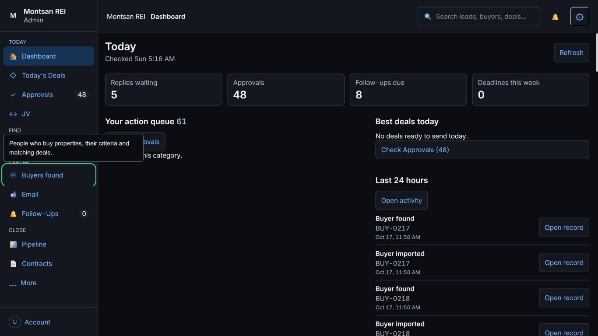
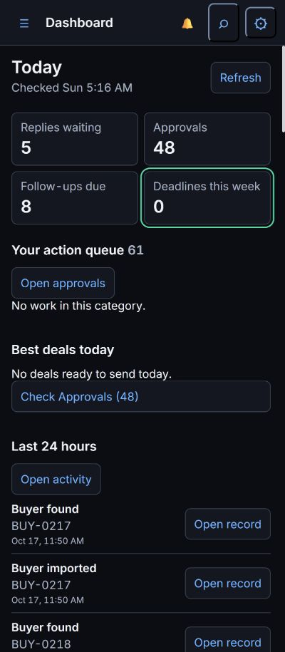
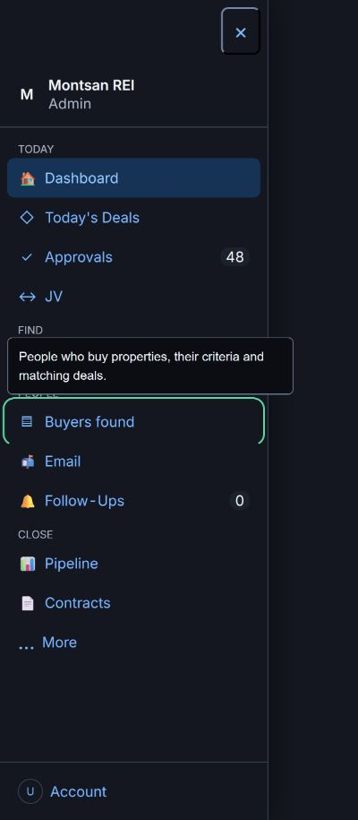
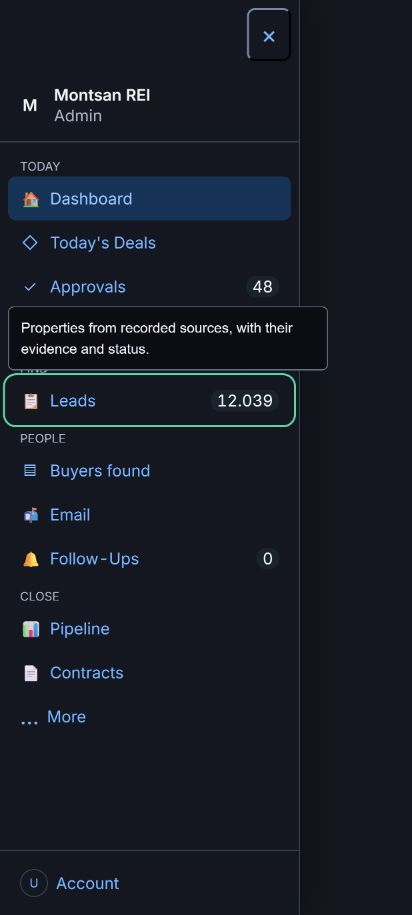

# Navigation And Today Copy Released

PR#387; tested92dd9d0a63b8de3223df7a3a475b17441a018440;
merge0b07f7d3cfbfa37036180f06e11d3247815a9583.
Hosted39125517308: SUMMARY passed=214 failed=0 skipped=0 total=214.
600s/file;11m26s. Navigation UI3.25s/unit0.24s; existing help7.16s;
voice UI3.97s; county-notice acquisition248.35s. Full durations:
docs/test-results/issue-366-copy-final/full-suite.txt.

Exact Railway7154386545 started12:13:33Z, succeeded12:14:43Z (70s).
Post-success health200; Help?v=4,Today?v=4,Voice?v=2 served.

Live checks at1366x768,400-wide and412x915:
-61 Today actions;5 replies,48 approvals,8 follow-ups,0 deadlines.
-No reference-only action headings. References remain metadata, not names.
-Best empty text links to Approvals;24 buyer review cards shown,0 review
 controls checked.48 is the existing total pending category count.
-Sidebar Leads/Buyers help describes the actual destination. Other generic
 non-navigation tooltips are not claimed fixed by this release.
-Phone menu opens/closes; no horizontal overflow.
-Real buyer Messages has one toolbar and no nested voice labels. No Mic,
 Read aloud, typing, save or Send action occurred.
-100 lead rows hydrate; a lead drawer opens and closes;console0errors.
-Temporary zero-Deadline filter cleared; viewport reset; dashboard left open.

Privacy-safe images use the actual zero-Deadline filter or navigation only,
not redacted/fabricated cards. This does not mean the61-action queue is empty.
No private owner names, contact details or street addresses are published.

No action membership/count/sort, business writer, readiness, comp, provenance,
auth or source rule changed. No audio, outreach, batch, capture, confirmation,
paid call, credential or settings change. C/I remain blocked#379/#383;
no full#341 sign-off inferred. Email read failure filed separately#388.
