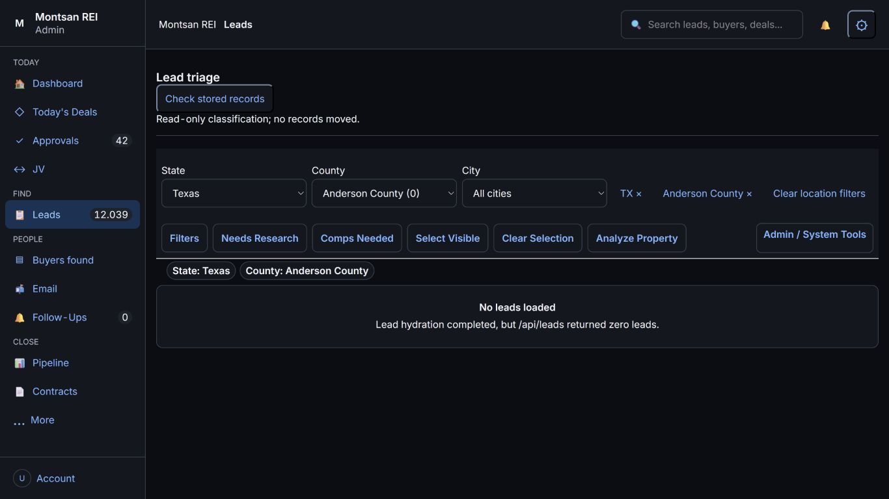
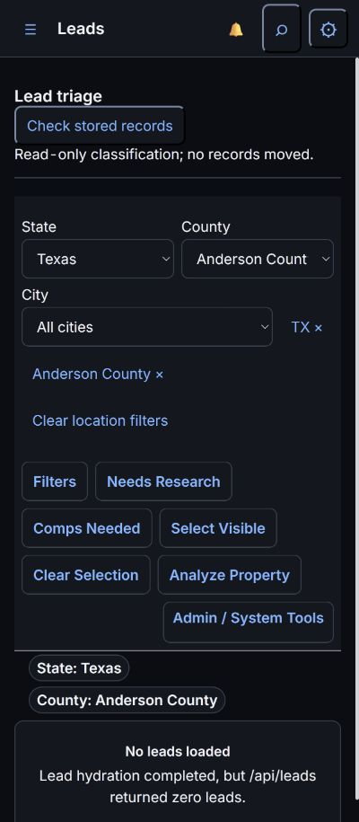
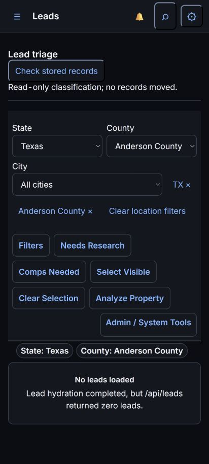

# G Released And Verified

PR #377: merge d9a64dd6fd4682b6adf018e45331d9c50c49fc55.
Exact Railway deployment7143682195 succeeded2026-10-17 18:13:47Z,
2m11s after deployment started. Post-success health200.

Hosted run39056128233 on97d2977663f2fb56be8a8500e454040e3de93aa8:
SUMMARY passed=197 failed=0 skipped=0 total=197.
Full durations: docs/test-results/issue-366-g-final.txt; job10m44s,
county-notice acquisition253.16s, geography UI10.32s, unit0.18s.

Read-only live click-through at1366,400,412:
- All states12039 total,10664 filtered; crossed server page1 to2.
- IL8983 -> Cook County8981 -> ALSIP32; parent changes reset children.
- Real zero-result county returns zero; clearing restores the full pool.
- Address-first cell opens drawer; X and Escape close it.
- Header/row checkboxes18px within44px targets; no mobile page overflow.
- Served CSS?v=3 and list-filters JS?v=2; console0errors.

Screenshots deliberately show a real zero-result county to avoid publishing
street addresses, owner names or contact information. Populated-row behavior
was checked separately without recording private data.

No batch, capture, helper restart, contact, evidence confirmation, settings
change or production business-data write. #366 remains open for C onward;
G is DONE. Buyer workspace C is next and is not yet built/released.
