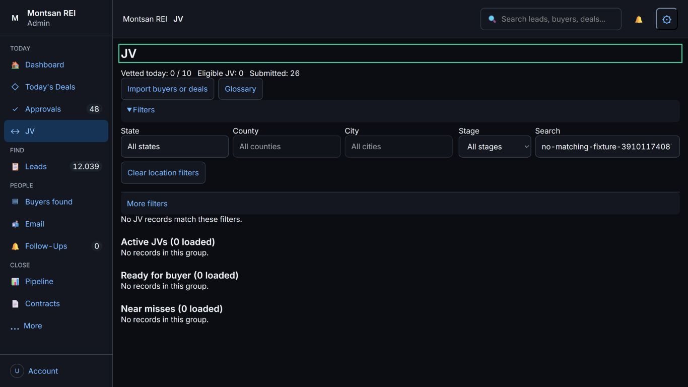
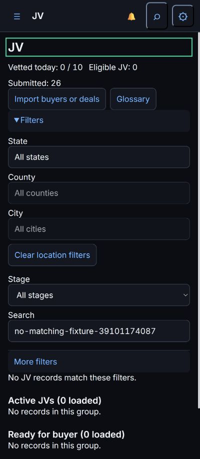
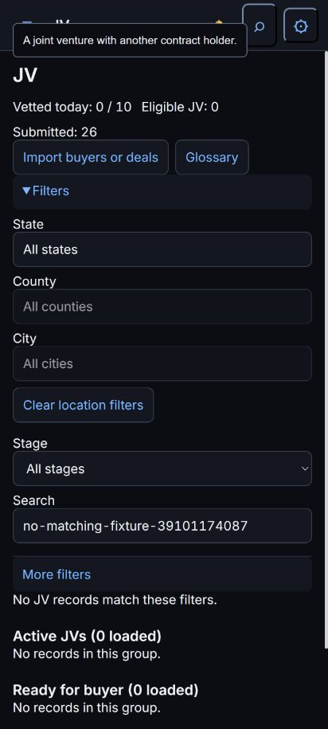

# JV Filters Released

PR #384; merge aa8190625086ade0210a9e7c3b7c009a3e4d77f0.
Tested head 932e58b20fbf47d0a78aca632e58ea0ae3b9db50.
Hosted run39101174087: SUMMARY passed=207 failed=0 skipped=0 total=207.
600s/file; job11m29s. New UI4.20s/unit0.36s; old filter4.77s,
shared geography UI9.30s; county-notice acquisition252.05s.
All timings: docs/test-results/issue-366-h-final/full-suite.txt.
Existing assertions unchanged. Four browser-driver selectors target only
the outer summary because More introduces a nested summary. Protected
gates/workflow/auth/writers/dependencies unchanged; list filtering only.
git diff --check clean; tests/.tmp absent.

Railway7150603340: start05:50:54Z, success05:51:42Z (48s).
Post-success health200. Deals script14 and JV tools JS/CSS1 served.
Live1366x768/400x915/412x915:
- 26 real JV cards; five primary location/stage/search fields.
- More initially closed; opens/closes existing price and advanced filters.
- Closed stage returns zero. Nonmatching search returns zero; clearing
  search and restoring All stages returns26. Search focus survives repaint.
- Phone controls44px, no horizontal overflow. Stage changes remain usable.
- 100Leads hydrate; real address opens/closes its drawer. Console0errors.
- Viewport restored. Initial Leads click at phone width found hidden nav;
  after restoring desktop viewport the actual navigation/drawer check passed.

Screenshots deliberately use an actual zero-result search so no private
street address, owner name or contact data is published. The412 image retains
an existing generic JV glossary tooltip; it does not cover a primary control.
Populated cards were checked separately without saving private content.

No business-data write, mail, import, approval, contact, capture, batch,
evidence confirmation, helper action, credential or settings change.
H DONE; I integration BLOCKED#383; C feed BLOCKED#379. B Calendar is live
for Gabriel's inspection; no full#341 sign-off inferred. Next independent J.
