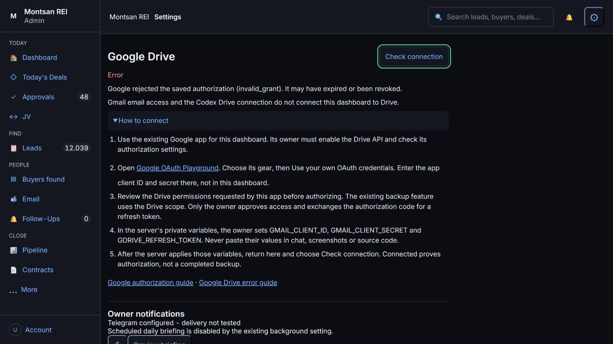
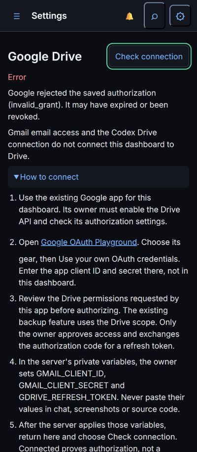
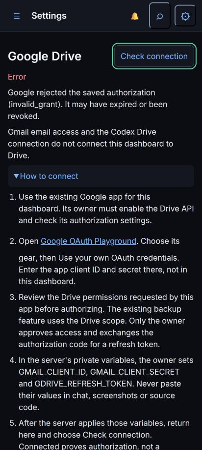
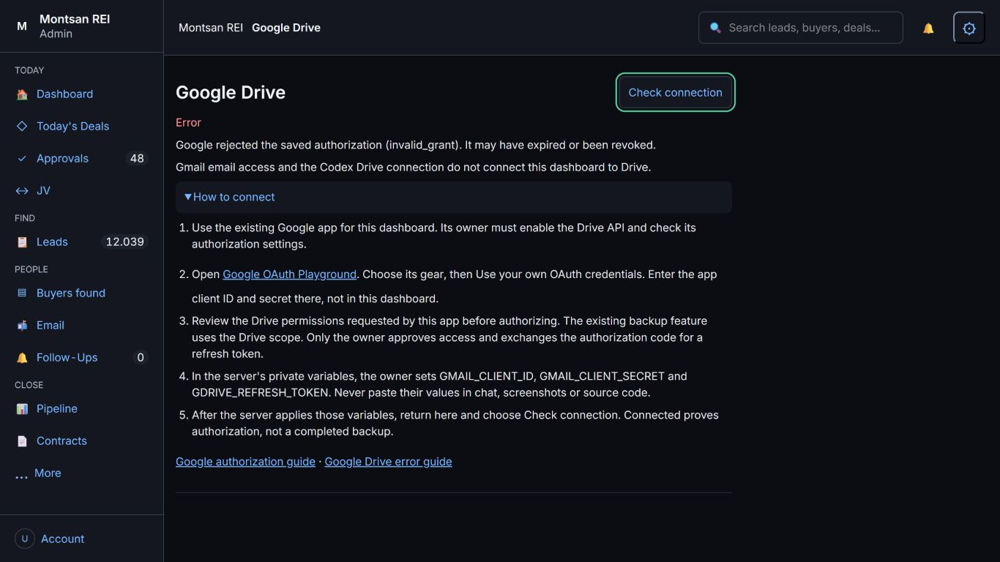
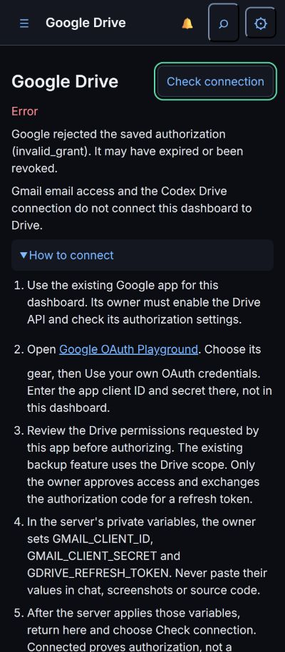
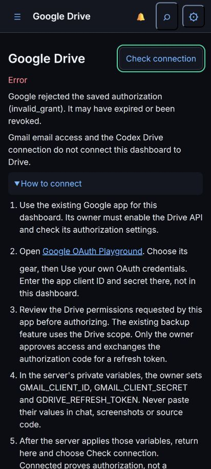

# Drive Status Released

PR#385; merge a1656954d5185904b74b003807f83fd0228bf40e.
Tested819ac1053adf5b538b3d8b9b2006e2886ab616f0.
Hosted39120526838: SUMMARY passed=210 failed=0 skipped=0 total=210.
600s/file; job11m10s. New UI3.18s/unit0.08s/routes0.32s;
real-server auth2.40s; county-notice acquisition246.23s.
Every timing: docs/test-results/issue-366-j-final/full-suite.txt.
No existing assertion changed. Auth/comp/value/readiness/JV/source/dependency
modules unchanged; route now narrows its read to admin and strips raw errors.
git diff --check clean; tests/.tmp absent; unrelated exports preserved.

Railway7153558215: in_progress10:57:44Z,success10:58:31Z (47s).
Post-success health200; Drive JS/CSS?v=1 served.
One health502 occurred while deploying. The first page also logged a lead502
at10:58:40Z after success; later100 rows hydrated. A separate fresh post-deploy
tab loaded100Leads, opened/closed its real address drawer and had0console
errors. The initial error is not erased or claimed never to have happened.

Live1366x768/400x915/412x915 Settings gear and More tools -> Google Drive:
- Both show Error and the exact safe reason:
  "Google rejected the saved authorization (invalid_grant). It may have expired or been revoked."
- How to connect expands; link destinations match Google's official guides.
  No authorization, grant, token exchange or variable change was attempted.
- Check connection performs the same bounded read and returns the same reason.
- No fake folder/file count, sync schedule or Backup Now action is rendered.
- Phone check button44px; no horizontal overflow. Viewport restored.
- No account details, owner/contact data, token, PIN or secret appears in proof.

A screenshot clip attempt timed out then retained odd framing; it was discarded.
Resetting the viewport restored normal full-page screenshot dimensions. Only
inspected full viewport images below were saved. A nonfocusable heading Escape
attempt failed; Escape on the check button dismissed the known global tooltip.
No product state was changed by either technical proof retry.

J status UI DONE. Actual Drive authorization remains owner-only repair;
this slice does not claim it is connected. No backup, production business
write, send, batch, capture, evidence confirmation, helper or settings action.
I contract/profile boundary BLOCKED#383; C feed reconciliation BLOCKED#379.
Calendar B is live for inspection; no complete#341 sign-off inferred.
Next independent owner item#370. Release checkpoint rides its branch rather
than trigger another docs-only deployment.
