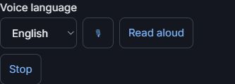
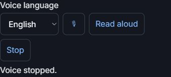
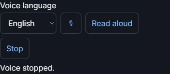

# On-Device Composer Controls Released

PR#386; merge3d432f4754b2bf47f3ea96ec5fbc7ceb5e8f96e7.
Tested5c1c5cf97d2dea5197dd302464c39c3b86f01ea5.
Hosted39123294146: SUMMARY passed=212 failed=0 skipped=0 total=212.
600s/file;11m14s. Voice UI3.98s/unit0.06s; JV safety2.88s;
county-notice acquisition251.46s. All durations retained under
docs/test-results/issue-370-final/full-suite.txt.
Initial39122408018 returned211/1/0: the JV driver counted the extra disabled
mic. Two selectors now target the original direct .td-actions controls;
expected3 and inert-Send assertions unchanged. No gate was weakened.
Server/module/dependency/auth/comp/readiness/provenance files unchanged.
git diff --check clean; tests/.tmp absent; unrelated exports untouched.

Exact Railway7154039363 started11:40:24Z,succeeded11:41:19Z (55s).
Post-success health200; voice JS/CSS?v=1 served.
Fresh Chrome tab recovered after the prior tab was released, without changing
browser/account or asking for credentials. Live1366/400/412:
- 68 buyer cards; a real buyer's Messages draft has exactly one voice toolbar.
- Mic enabled means the browser exposes the explicit on-device API. Installed
  English/Spanish packs and actual speech accuracy were NOT measured.
- English/Spanish selection and Stop work; the existing draft length stays290.
- Native controls44px; no horizontal overflow. No microphone or Read aloud
  was pressed; no draft typing/save, send, contact or confirmation occurred.
-100Leads hydrate; real address drawer opens/closes; console0errors.
-Viewport restored and a verified dashboard tab left open.

Email observation, not hidden: Inbox listed28 messages, but opening the first
one ended at "Email unavailable. Check the connection in Settings." No live
email-composer success is claimed. This request/reader path and server code
are unchanged by the voice slice; synthetic full email integration passes.
Record the read failure for independent diagnosis, without a provider/settings
change, retry loop or sending a test message.

Live images show only the toolbar, cropped to exclude private buyer names,
contact details and draft text; source viewports were1366,400,412 respectively.
The browser clip API initially timed out and scroll anchoring shifted geometry.
Only freshly measured, inspected, private-free images were saved; other images
were discarded, not edited or published. Known generic help overlay remains
an architect-requested#366 correction, not claimed fixed by voice.

No audio capture/playback, business write, outreach, batch, evidence confirmation,
helper action, paid call, credential/setting or source change. The full#370
assistant commands depend on#372; this release is the reusable composer slice,
not an AI assistant or universal browser-speech support claim.
I/C remain BLOCKED#383/#379; no complete#341 sign-off inferred.
