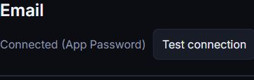

# Email Read Failure Diagnostic Slice

An Inbox read can succeed while an individual body fails. The old client
discarded the Inbox and labeled the connection broken for every failure.
This slice keeps the list and last observed status for ordinary body errors.
Known size, stale reference, missing reference, invalid reference and busy
codes get fixed English instructions; unknown errors remain unknown.
Dashboard401/403 still clears private content. No raw provider error renders.

Trace: modules/email/mailbox-reader.js owns bounded read-only IMAP/MIME
and OAuth reads and the safe email_* route codes; untouched. Its list/read
methods and registerMailboxReads are the only mailbox reader routes.
dashboard/wos-email-reader.js request writes status/error/messages/notes/
thread/body/reply; load, renderGmail and folder selection initialize lists;
the selected-message click supplies keepList only for body/thread requests.
markup/statusPanel/threadRows/reading consume that state. Test connection
and folder loads keep their existing behavior. No business writer is added.
dashboard/index.html consumes the reader with cache version5.

New email-read-errors test injects reader errors into the actual route,
verifies no-store/redaction, then exercises the real dashboard at1366/400/412.
It checks known and malicious/prototype-key unknown codes, one read per click,
no retry, retained list, successful subsequent reading, inert Send and private
DOM cleared on401. Network is fixture-only; no provider or write request.
Existing assertions unchanged. The initial new driver expected a visible
alert behind the shared401 login overlay; it now checks attached DOM and
empty private lists, without changing auth or weakening that privacy check.

Released PR#389, merge dbe6d5cce549c5938d9fe750af867240d8ddbaba.
Tested b3b139a8d46371e00276ee48d638ca3bf188819e.
Hosted39146438483: SUMMARY passed=215 failed=0 skipped=0 total=215.
600s/file,11m51s; new error proof5.96s,mailbox1.34s,thread1.36s,
county-notice acquisition254.45s. All timings retained in
docs/test-results/issue-388-final/full-suite.txt.

Exact Railway7157743736 started16:59:00Z,succeeded16:59:48Z (48s).
Post-success health200;reader?v=5 served. One ordinary live Inbox body
read succeeded:30 messages,1 body,Connected (App Password),no alert.
The same opened message fits1366/400/412 without additional reads;
Send remains disabled; Back restores the list.100Leads and the address
drawer work;console0errors;viewport restored and dashboard left open.
No private message contents or identity are reproduced here or in images.
Images crop only the actual public connection header. The screenshot
backend timed out on clip calls; subsequent capture returned the requested
crop, inspected before saving. No image manipulation or private DOM hiding.

The historical live cause remains unknown. Error behavior is demonstrated
with hermetic cases, not induced on production. This release does not prove
that a previously failed message became readable or that credentials failed.
#388 remains open for concrete evidence, not an automatic read/retry loop.
No business write, send, connection test, link save, import, provider/secret
change, audio, batch, capture or evidence confirmation occurred.

